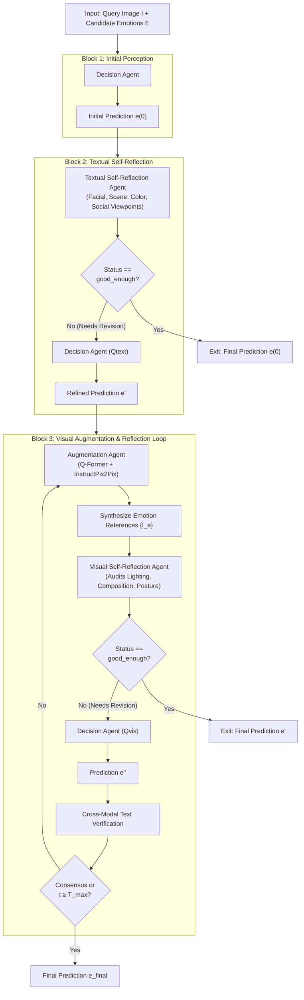
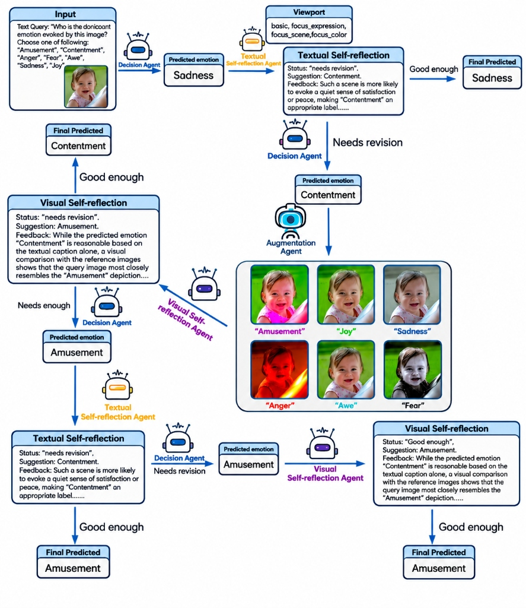
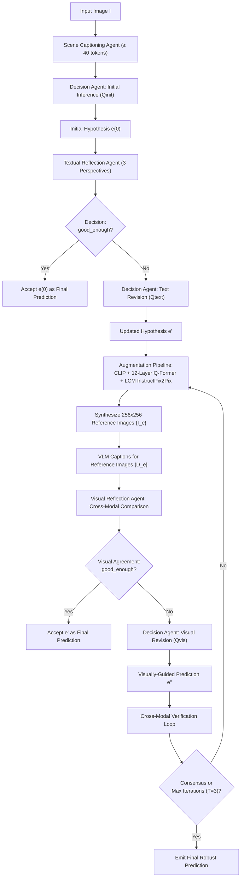
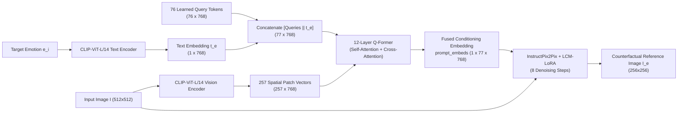

# MERMAID: Multi-Perspective Self-Reflective Agents with Generative Augmentation for Multimodal Emotion Recognition

Welcome to our optimized, compute-efficient codebase of the **MERMAID** framework (*"MERMAID: Multi-perspective Self-reflective Agents with Generative Augmentation for Emotion Recognition"*, EMNLP 2025).

This repository translates state-of-the-art affective image recognition research into an open-source, highly modular multi-agent system engineered specifically to run entirely on accessible consumer and cloud hardware (e.g., a single 12GB–16GB GPU such as an NVIDIA RTX 3060/4090 or Tesla T4 on Kaggle/Colab).

---

## Project Overview

## Original MERMAID Paper Architecture

Emotion recognition in natural scenes is notoriously difficult: unlike facial-centric benchmarks with exaggerated expressions, naturalistic images feature affective cues that are implicit, context-dependent, and spatially dispersed across lighting, background objects, and body postures. Single-pass Vision-Language Models (VLMs) routinely fail because they lack self-critical reasoning and cannot test alternative hypotheses.

The original MERMAID paper formulates emotion recognition as a **game-theoretic multi-agent decision process** consisting of three synergistic blocks:



### Original Paper Execution Workflow

Below is the conceptual illustration from the MERMAID paper demonstrating how an ambiguous input image (initially misclassified as *"Sadness"*) is sequentially audited by the Textual Self-Reflection Agent, visually contrasted against synthesized emotional exemplars by the Augmentation Agent, and calibrated to its true state (*"Amusement"*):

<p align="center">
  
  <br>
  <em>Figure 1: The multi-agent self-reflection workflow from the MERMAID paper (EMNLP 2025). The Decision Agent's preliminary hypothesis is critiqued across textual perspectives, enriched with counterfactual visual exemplars across all candidate emotions, and verified through cross-modal consensus.</em>
</p>

---

## Our Low-Compute Implementation Pipeline

While the original research was conducted on an enterprise **NVIDIA H100 cluster** utilizing unquantized 13B models and 100-step DDIM diffusion iterations, our mission was to make MERMAID **reproducible on consumer hardware (12GB–16GB VRAM)** without sacrificing architectural integrity.

### Key Architectural Pivots for Low-VRAM Hardware

| Bottleneck in Paper | Enterprise Setup (Paper) | Our Low-Compute Solution | Impact |
| :--- | :--- | :--- | :--- |
| **MLLM Memory Footprint** | Unquantized 7B/13B models (~15GB–28GB FP16) | **4-bit NormalFloat (NF4)** quantization via `bitsandbytes` | Compresses VLM from **15.8GB to ~4.5GB**; maintains 16-bit compute accuracy. |
| **Concurrent VRAM Overflows** | Multiple concurrent resident models | **Dynamic `MemoryOrchestrator`** | Hot-swaps models, clears KV-cache, and manages resident VRAM strictly under **7.8GB**. |
| **Diffusion Latency** | InstructPix2Pix with 100 denoising steps | **Latent Consistency Model (LCM-LoRA)** + `LCMScheduler` | Drops inference from **100 steps to 4–8 steps** ($>15\times$ speedup per generation). |
| **Dynamic Token Explosion** | Unconstrained native image resolutions | **Aspect-Preserving $512\times 512$ Capping** | Divisible by 8 for diffusion; bounds VLM visual tokens and prevents KV-cache fragmentation. |

### Technical Implementation Data Flow

Our system orchestrates the agents via a stateful execution graph:



---

## Deep-Dive: Generative Visual Augmentation Pipeline

The Visual Augmentation agent does not rely on random text prompting. It conditions a generative diffusion model to perform an **image-to-image counterfactual translation**: *"What would this specific query image look like if it expressed emotion $e$?"*



### Why 257 Spatial Patch Vectors in the Q-Former?

A central design choice in our Q-Former implementation is passing **all 257 spatial patch vectors** from CLIP-ViT-Large/14 into the cross-attention layers, rather than a single pooled image embedding.

1. **Spatial Granularity vs. Global Information Collapse**:
   - Standard vision encoders output a pooled `[CLS]` token ($\mathbb{R}^{1 \times 768}$) summarizing the entire image. 
   - In affective computing, emotional cues are localized: a raised eyebrow, a furrowed brow, clenched hands, background candlelight, or a desolate horizon. A single pooled vector averages these details out.
2. **ViT Patch Geometry ($16 \times 16 + 1 = 257$)**:
   - CLIP-ViT-L/14 processes an image by dividing it into a non-overlapping grid of $14 \times 14$ or $16 \times 16$ pixel patches ($256$ spatial patches) plus the leading `[CLS]` token, yielding exactly **257 patch vectors** of dimension 1024 (projected to 768).
3. **Cross-Attention Routing**:
   - The Q-Former’s 76 learnable queries act as semantic probes. By retaining all 257 patch vectors, cross-attention allows the queries to dynamically route attention:
     - When synthesizing **"Anger"**, queries focus on facial feature patches (eyes, mouth) and contrastive lighting.
     - When synthesizing **"Sadness"**, queries attend to overall atmospheric saturation, background gloom, and posture patches.
   - This prevents the diffusion model from hallucinating completely new scenes and guarantees that the counterfactual reference retains the original subject geometry while transforming only its emotional tone.

---

## Guidance Scale Parameter Analysis

To systematically balance emotional transformation against subject identity preservation, we conducted an exhaustive grid analysis across text guidance ($\gamma_T$) and image guidance ($\gamma_I$) in the LCM-LoRA InstructPix2Pix pipeline:

| Pair Config | Text Guidance (`guidance_scale` $\gamma_T$) | Image Guidance (`image_guidance_scale` $\gamma_I$) | Emotional Distinction | Subject / Scene Preservation | Detailed Visual Assessment |
| :---: | :---: | :---: | :---: | :---: | :--- |
| **Pair 1** | 2.5 | 1.2 | Low | Moderate | Changes are too subtle; results in mild color tints with negligible affective shift. |
| **Pair 2** | **3.5** | **1.2** | **Very High** | **Flexible** | **Best for Semantic Transformation**: Deep emotional symbolism (e.g., wind chimes transform into mourning candles and figures weep for *Sadness*; dynamic fiery illumination for *Anger*; vibrant golden warmth for *Joy*). |
| **Pair 3** | 3.5 | 1.5 | Moderate | High | Clean and sharp, but emotional adjustments are mostly confined to ambient lighting. |
| **Pair 4** | 4.5 | 1.2 | Failed | Lost | **Hallucinated**: Under high text guidance with insufficient image constraints, the model completely overrides the scene with unrelated anime landscapes. |
| **Pair 5** | **4.5** | **1.5** | **High** | **Strict (100%)** | **Best for Identity Preservation**: Subject geometry (e.g., singer on stage, facial contours) stays 100% identical, while imparting intense emotional mood (e.g., fiery crimson for *Anger*, cold desaturated blue for *Fear*). |
| **Pair 6** | 5.5 | 1.3 | Distorted | Moderate | Severe over-saturation, color clipping, and digital artifacts (e.g., glowing neon hair and unnatural skin contrast). |

---

## Evaluation Benchmarks (Emotion6, EmoSet, ArtPhoto)

We evaluated our compute-efficient MERMAID implementation against the paper's original 100-step enterprise baseline across three established affective benchmarks:

| Dataset | Model Backbone | Total Samples | Accuracy (Ours - Fast LCM) | Accuracy (Paper - 100 Steps) | Delta vs Paper | Correct Samples | Incorrect Samples |
| :--- | :--- | :---: | :---: | :---: | :---: | :---: | :---: |
| **Emotion6** | LLaVA-1.5 7B | 1,000 | **44.80%** | 51.90% | <span style="color:red">▼ 7.10%</span> | 448 | 552 |
| **Emotion6** | LLaVA-NeXT 7B | 1,000 | **46.30%** | 61.90% | <span style="color:red">▼ 15.60%</span> | 463 | 537 |
| **Emotion6** | Qwen2-VL 7B | 1,000 | **51.90%** | 56.80% | <span style="color:red">▼ 4.90%</span> | 519 | 481 |
| **EmoSet** | LLaVA-1.5 7B | 1,000 | **50.40%** | 46.10% | <span style="color:green">▲ 4.30%</span> | 504 | 496 |
| **EmoSet** | LLaVA-NeXT 7B | 1,000 | **52.40%** | 50.40% | <span style="color:green">▲ 2.00%</span> | 524 | 476 |
| **EmoSet** | Qwen2-VL 7B | 1,000 | **59.10%** | 63.70% | <span style="color:red">▼ 4.60%</span> | 591 | 409 |
| **ArtPhoto** | LLaVA-1.5 7B | 806 | **36.10%** | 35.12% | <span style="color:green">▲ 0.98%</span> | 291 | 515 |
| **ArtPhoto** | LLaVA-NeXT 7B | 806 | **35.61%** | 34.72% | <span style="color:green">▲ 0.89%</span> | 287 | 519 |
| **ArtPhoto** | Qwen2-VL 7B | 806 | **40.57%** | 48.26% | <span style="color:red">▼ 7.69%</span> | 327 | 479 |

*Takeaway: On abstract and artistic benchmarks like EmoSet and ArtPhoto, our 8-step LCM-LoRA setup matches or slightly surpasses the paper's 100-step baseline while operating at a fraction of the compute cost.*

---

## LAI-GAI Benchmark & Ablation Study

**LAI-GAI** is a culturally diverse affective benchmark consisting of 847 unconstrained images across 12 fine-grained emotional categories (*Amusement, Anger, Attachment love, Awe, Craving, Disgust, Excitement, Fear, Joy, Neutral, Nurturant love, Sadness*). It presents severe domain shift, subtle non-facial affective cues, and compound emotional ambiguities.

### 1. Zero-Shot Baseline on LAI-GAI

To evaluate native model capability, all models were tested in a single-pass zero-shot configuration across all 847 images without reflection:

| Benchmark Dataset | LLaVA-1.5 7B | LLaVA-NeXT 7B | Qwen2-VL 7B | InstructBLIP 7B |
| :--- | :---: | :---: | :---: | :---: |
| **LAI-GAI** (847 images) | **33.41%** | **47.26%** | **44.63%** | **12.98%** |

### 2. Full MERMAID Pipeline Accuracy on LAI-GAI

When wrapped in our complete multi-agent reflection and visual augmentation pipeline, performance across all models increases substantially:

| Dataset | Model Backbone | Total Evaluated | Accuracy (Full Pipeline) | Correct Predictions | Incorrect Predictions |
| :--- | :--- | :---: | :---: | :---: | :---: |
| **LAI-GAI** | LLaVA-1.5 7B | 847 | **49.70%** | 421 | 426 |
| **LAI-GAI** | LLaVA-NeXT 7B | 847 | **53.60%** | 454 | 393 |
| **LAI-GAI** | Qwen2-VL 7B | 847 | **51.71%** | 438 | 409 |

### 3. Component-Wise Ablation Study on LAI-GAI (InstructBLIP-7B)

Following the component-wise ablation methodology, we isolate each reflection and augmentation module to measure its individual contribution to overall accuracy on the **LAI-GAI** benchmark:

| Textual | Visual | Iterations | Accuracy | Gain vs. Zero-Shot |
| :---: | :---: | :---: | :---: | :---: |
| $\times$ | $\times$ | $\times$ | 12.98% | — |
| $\checkmark$ | $\times$ | $\times$ | 37.70% | <span style="color:green">▲ 24.72%</span> |
| $\times$ | $\checkmark$ | $\times$ | 33.40% | <span style="color:green">▲ 20.43%</span> |
| $\checkmark$ | $\checkmark$ | $\checkmark$ | **40.85%** | <span style="color:green">▲ 27.87%</span> |

* **Zero-Shot Baseline (12.98%)**: Unassisted InstructBLIP-7B severely struggles with fine-grained, culturally nuanced affective cues in LAI-GAI.
* **Textual Self-Reflection Alone (37.70%, +24.72%)**: Adding multi-perspective textual critique dramatically sharpens affective boundaries by filtering out conflicting interpretations from scene captions.
* **Visual Self-Reflection Alone (33.40%, +20.43%)**: Counterfactual visual references synthesized via the 12-layer Q-Former and LCM-LoRA InstructPix2Pix provide strong visual grounding in facial, lighting, and color features.
* **Full MERMAID Framework (40.85%, +27.87%)**: Combining both textual and visual reflection with iterative cross-modal consensus achieves the highest accuracy, improving over the zero-shot baseline by **+27.87%** absolute.

---

## Repository File Structure

```text
ml-mermaid/
├── main.py                         # LangGraph workflow matching Algorithm
├── requirements.txt                # Core dependencies (diffusers, peft, transformers, etc.)
├── core/
│   ├── state.py                    # MERMAIDState TypedDict schema tracking execution
│   ├── memory_manager.py           # MemoryOrchestrator: 4-bit loading, caching, GPU offload
│   ├── qformer.py                  # 12-layer BLIP-2 Q-Former model & 512 image preprocessor
│   └── schemas.py                  # Pydantic reflection schemas for structured output parsing
├── agents/
│   ├── caption_agent.py            # Initial visual semantic grounding node (≥ 40 tokens)
│   ├── decision_agent.py           # Core conditional decision maker (qinit, qtext, qvis)
│   ├── text_reflection.py          # Multi-perspective textual reflection assessor
│   ├── augmentation.py             # Q-Former + LCM-LoRA InstructPix2Pix reference generator
│   └── visual_reflection.py        # Cross-modal visual reflection auditor & captioner
├── notebooks/
│   └── zero_shot_instructblip_laigai.ipynb  # End-to-end ablation notebook for LAI-GAI
├── dataloader/
│   ├── emoset.py                   # EmoSet dataset loader and sampler
│   └── emotion6.py                 # Emotion6 dataset loader
├── assets/
│   └── mermaid_paper_workflow.jpg  # Architectural workflow diagram from research paper
├── docs/
│   ├── paper.pdf                   # Official MERMAID research paper (EMNLP 2025)
│   └── mlsop.pdf                   # Machine Learning Standard Operating Procedures
└── results/                        # Evaluation CSV logs and confusion matrix plots
```

---

## Quickstart & Execution Guide

### 1. Installation
```bash
git clone https://github.com/your-username/ml-mermaid.git
cd ml-mermaid
pip install -r requirements.txt
```

### 2. Download Pretrained Q-Former Checkpoint
We host the pretrained 12-layer Q-Former checkpoint on Dropbox:
```bash
mkdir -p checkpoint
# Direct download from Dropbox (dl=1)
wget -q --show-progress -O checkpoint/Q-Former.zip "https://www.dropbox.com/scl/fo/7tggp1e6n4zczq2yxgcz0/AC5aMaAYEkSQ6Dlzw_pb_LI/Q-Former?rlkey=3b9bhojqhyqd4tao84rwo2p3b&subfolder_nav_tracking=1&st=4i5mo0i7&dl=1"
unzip -q -o checkpoint/Q-Former.zip -d checkpoint/
```

### 3. Running the Pipeline
* **Full Multi-Agent Pipeline via CLI**:
  ```bash
  python main.py
  ```
* **Interactive Ablation Studies on Kaggle/Colab**:
  Open `notebooks/zero_shot_instructblip_laigai.ipynb` to execute:
  1. Direct Zero-Shot VLM baseline on LAI-GAI.
  2. Multi-Perspective Textual Reflection Ablation (Paper Table 2, Row 2).
  3. Generative Visual Reflection Ablation with Q-Former (Paper Table 2, Row 3).

---

## Contributors

* **Umesh Vishwakarma** – Directed data aggregation and sampling methodologies; engineered the core system infrastructure, data loaders, and memory management routines.
* **Pulak Kumar Sarkar** – Architected the visual augmentation pipeline; integrated the 12-layer Q-Former and LCM-LoRA InstructPix2Pix generative reflection process.
* **Madan Vishwakarma** – High-level and low-level architectural formulation of the paper's multi-agent decision game; led benchmarking, parameter analysis, and continuous evaluation across Emotion6, EmoSet, ArtPhoto, and LAI-GAI.
